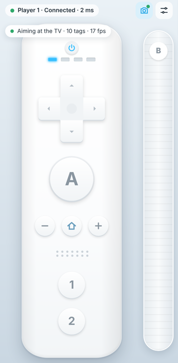

# Camera tracking and calibration

> **Status (2026-10-12):** pointing math, gyro fusion, tag rendering, the TV border page (`/tracking`), HTTPS for
> phones, PC-side detection and the phone's camera and gyro streaming are implemented. They are tested
> synthetically and with a simulated phone camera. The calibration UI is built (protocol messages `calibrate`,
> `aim`, `calibration`). Not done yet: physical measurements on real phones.
>
> **TV border during play (2026-10-13, Windows):** while a Wii Remote phone's camera is on, Wii U Connect draws the
> same tags around Cemu's game and shrinks the game to fit (`crates/wiiu-connect/src/tv_border/`,
> [ADR-0004](adr/0004-tv-border-during-play.md)). `wiiu_tracking::screen_layout` computes the pixels with the same
> math as the `/tracking` page. Phones get `border: "game"` in `tracking` messages and say "Aim at the middle of the
> game" when calibrating. Unverified with real Cemu on a TV.

## Important ergonomic constraint: camera orientation

A phone's rear camera looks out of the **back** of the phone, but a Wii Remote points along its **long axis**. If
a phone is held like a Wii Remote (top edge toward the TV, screen facing up), its camera looks at the floor and
cannot see the markers. There are two workable grips:

1. **"Photo grip" (no accessory):** the phone is held upright with its back facing the TV and the screen facing
   the player. The pointing direction is the camera axis. The buttons stay on screen under the thumbs. This needs
   no hardware and is the default the math assumes (aim image point = image centre).
2. **Periscope grip (3D-printed accessory):** a 45° mirror clip over the rear camera turns its view by 90°, so
   the phone can be held like a real Wii Remote. The mirror flips the image, which a homography handles. The
   calibration step absorbs the changed pointing direction (`calibrate_aim_point`).

This must be validated physically with real phones before the controller UI is finalised.

## Server pipeline (protocol v2)

The phone sends `camera_frame` (binary JPEG) and `gyro` messages. A worker thread per Wii Remote runs
decode → detect → `Tracker` and writes the pointer into that player's DSU slot, overriding the phone's own
`pointer` field for 2 s after each update. When frames arrive faster than they can be processed, only the newest
is kept. The phone receives `tracking` feedback at about 10 Hz. An end-to-end test drives this path with a real
JPEG over the WebSocket and checks the pointer Cemu would receive.

## Phone side (protocol v2)

The camera button in the phone's top bar turns camera pointing on (`apps/phone/src/tracking/`):

- **Camera:** the rear camera is requested at 1280×720. Asking for 4:3 made Chromium crop the sides off, and only
  4 of 10 tags stayed visible. Frames are scaled so the long side is at most 640, encoded as JPEG, and sent as
  binary `camera_frame`s. Capture time comes from `requestVideoFrameCallback`, falling back to `performance.now()`.
  Frame pacing:
  - The target is 30 fps, with one encode in flight at a time.
  - A frame is only sent once the socket has drained (≤ 16 KiB buffered), so frames never queue and never delay
    button snapshots.
  - JPEG quality adapts to keep frames under the 64 KiB limit.
- **Gyro:** `DeviceMotionEvent.rotationRate` is converted to rad/s in the device frame and sent in batches of
  16 ms or less, on the same `performance.now()` clock as the camera. On iOS, motion access is requested from the
  tap. If it is denied, the camera works alone.
- **Privacy and lifecycle:** the camera stops when the page is hidden and restarts when it comes back. It stops
  for good when the user leaves the controller screen.
- **Feedback:** the status line shows the PC's `tracking` message ("Aiming at the TV · 10 tags · 18 fps", "Tags
  out of view · using motion", or "Point the back camera at the TV border").

**Simulated check (dev container, 2026-10-12).** Chromium was given a fake camera playing a 1280×720 capture of
`/tracking`, and the phone page connected over `wss` to the real server:
- All 10 tags were detected, at about 18 fixes/s. The rate is limited by software JPEG encoding in headless
  Chromium.
- The server pointer was (0.500, 0.500), and DSU slot 1 reported touch (960, 471), the screen centre Cemu would
  receive.

Real phones, real TVs, lighting and motion blur are still unmeasured.

## First real-phone feedback and fixes (2026-10-12)

The repository owner tried camera pointing with an iPhone on Windows. It "works, but poorly": jittery, laggy,
often lost, and sometimes moving in the wrong direction, at 10–20 fixes/s.

**Root cause of the losses, measured** with `crates/wiiu-tracking/tests/realistic.rs`. That benchmark renders the
border as a portrait phone camera sees it, 0.8–2.5 m from a monitor with a 0.5 m game area, adding perspective,
blur, sensor noise and JPEG compression. With the phone upright, the monitor spans the frame's *short* side:

| Setup | 0.8 m | 1.2 m | 1.8 m | 2.5 m | Detect time |
|-------|-------|-------|-------|-------|-------------|
| Before: 360×640 frames, tags 0.10, decimate 2 | 5.9 tags | **0** | **0** | **0** | 9 ms |
| After: 540×960 frames, tags 0.20, decimate 1.5, 4 threads | 4 tags | 10 | 10 | 9.8 | 17 ms |

So beyond about 1 m every tag vanished. The fixes:
- **Range:** frames grow from 640 to 960 px on the long side, tags from 10% to 20% of the game height, and the PC
  detector uses decimation 1.5 on up to 4 threads.
- **Wrong direction / lag:** the tracker now checks the gyro against the camera. For each pair of consecutive
  fixes it compares what the gyro alone predicted with what the camera then saw, and fits a 2×2 map from those
  samples. The map corrects swapped axes, flipped signs and wrong scales, or becomes zero (the pointer then holds
  between fixes) when the gyro predicts nothing. This matters because phone sensor conventions can't be verified
  without each phone.
  - Synthetic tests: a phone reporting flipped yaw at 3× scale is learned as about −0.31/+0.35 (ideal ±0.33).
    Prediction error drops from 6.2% to 0.17% of the screen.
- **Jitter:** a One Euro filter smooths the pointer (strong smoothing when still, little lag when moving fast).
- **Diagnostics:** `/tracking` shows per player the frame size, frames/s, fixes/s, tags, detection time, gyro
  samples/s and the learned gyro map. A screenshot of it is the most useful bug report.

Still to verify on the real iPhone.

**Follow-up (same day):** reading WebKit's source showed that iOS reports `rotationRate` as alpha/beta/gamma = device
x/y/z, while the spec says z/x/y (research.md §6b). The phone sent permuted gyro axes, which the 2×2 gyro check
cannot fully undo, because the yaw rate arrived on an axis it ignores. The phone now reads iOS axes correctly. Whether
this cures the "wrong direction" symptom is **unverified** until the next iPhone test.

## Decision: detection runs on the PC

See [ADR-0001](adr/0001-apriltag-detection-on-pc.md). The native AprilTag detector found all 10 rendered tags (IDs
and corner order verified) in 1.13 ms per 640×360 frame in the dev container.

## Implemented (crates/wiiu-tracking)

| Module | What it does | Tests |
|--------|--------------|-------|
| `markers` | Lays out square `tag36h11` tags clockwise in a border just outside the game image, in game-normalised coordinates (same space as the protocol `pointer`). | ids unique, tags square in px, no overlap with the game |
| `homography` | Normalised DLT (Hartley-Zisserman 4.2) with a Jacobi eigen-solver; rejects degenerate input. | exact recovery, degeneracy rejection |
| `aim` | `estimate_aim`: image → game homography from all visible tag corners, aim = H(aim image point); rejects < 2 tags or reprojection RMS > 3 px. `calibrate_aim_point`: per-device pointing-axis calibration. | synthetic camera (below) |

| `fusion` | `PointerFusion`: between camera fixes, rotates the pointing ray by the gyro-integrated rotation and maps it through the last homography; a fix resets the drift. Tracking → GyroOnly after 0.3 s without fix → Lost after 2 s. | pure-rotation exactness, focal-length error, gyro bias with 30 fps fixes, state transitions |
| `pipeline` | `Tracker`: anchors each fix at the frame's capture time and replays the gyro samples recorded after it (latency compensation; exact in synthetic tests). | late-frame replay, out-of-order frames, bounded history |
| `detect` (feature `detector`) | JPEG → grayscale, then the vendored AprilTag C detector. | real-JPEG end-to-end, size-mismatch rejection |
| `tags` / `tag36h11` | Official tag36h11 code table and renderer (10×10 cells incl. quiet zone). | table integrity, Hamming distance ≥ 11 under rotation |

Synthetic results (`tests/synthetic.rs`, 1280×720 camera, f = 1000 px, 2–4 screen heights away, random
yaw/pitch/roll/offset):

- Noise-free: aim matches the ray-plane ground truth to < 1e-6 across ≥ 200 random poses.
- 0.5 px Gaussian corner noise: median error 0.023 % and 95th percentile 0.057 % of the screen width
  (300 poses). On a 1920 px wide TV, that is about 0.4 px median and 1.1 px p95.
- Rolling the phone around its pointing axis does not move the aim point, as on a real Wii Remote.
- Calibration of an offset pointing axis (8° / 5°) brings errors within 1 % of the screen.

- Gyro fusion: pure rotation for 0.25 s matches truth to < 1e-6. A 10 % focal-length error stays within 2 %
  after a 5° turn. A gyro bias of 0.02–0.03 rad/s with 30 fps camera fixes keeps the error below 0.5 % of the
  screen.

These are idealised numbers. Real detection adds corner bias, blur and rolling-shutter effects, so physical
measurements are still required.

## Goal

Each Wii Remote phone points its rear camera at the TV. AprilTag markers around the edge of the game image let
the phone compute where on the screen it is aiming, as normalised `(x, y)`. The phone sends that value as
`pointer` in the protocol, and the server forwards it to that player's DSU touch point. Each phone computes its
own pointer, so players never share a cursor.

## Plan

1. **Marker border.** Render `tag36h11` AprilTags (unique IDs per position) in a thin frame around the Cemu game
   image. The frame is an overlay window on the TV output. Marker size and count are configurable. Corner tags
   are the minimum; edge tags add robustness when part of the screen is out of view.
2. **Detection on the phone.** Run AprilTag detection on camera frames in a Web Worker (WASM build of the
   AprilTag C library), at a reduced resolution of about 640×360 to keep latency and battery use acceptable.
3. **Pose → pointer.** With known tag positions in screen coordinates, estimate a homography from camera image
   to screen plane from all detected tag corners (RANSAC when there are more than 4 points). The aim point is
   where the camera's optical axis, adjusted for the camera's offset from the phone's "pointing" axis, hits the
   screen plane.
4. **Fusion.** Between camera frames, and while markers are lost, integrate the gyroscope to propagate the aim
   point. Each camera fix corrects the drift (complementary filter first, EKF if needed).
5. **Calibration.** A one-time step removes the camera-to-pointing-axis offset: tap **Calibrate pointer**, aim at
   the centre cross during a 3-second countdown, and the PC turns the next camera fix into the aim point
   (`calibrate_aim_point`). The phone stores it (`localStorage`) and sends it as `aim` on every connection, since
   it belongs to that phone's camera and grip. It is a countdown rather than "press A", so the game never sees the
   button.
6. **Fallbacks.** If markers stay lost for more than 300 ms, keep a gyro-only pointer for up to 2 s, then send
   `pointer: null`. Manual recentre: hold `B` and press `HOME`.

## Metrics to measure (per phone model)

- Aiming error in screen px at the centre and corners (target: < 1% of screen width).
- Motion-to-pointer latency (target: < 50 ms).
- Drift per minute while gyro-only.
- Time to recover after markers come back into view.

## Test strategy

- Deterministic tests with synthetic camera poses: project the tag corners with a known pose, run the
  estimator, and compare the aim point.
- Recorded image fixtures (real phone captures of the border) for regression tests of detection.
- Physical tests on real phones, recorded in `docs/compatibility.md`. Browser emulation cannot validate
  cameras or gyroscopes.
